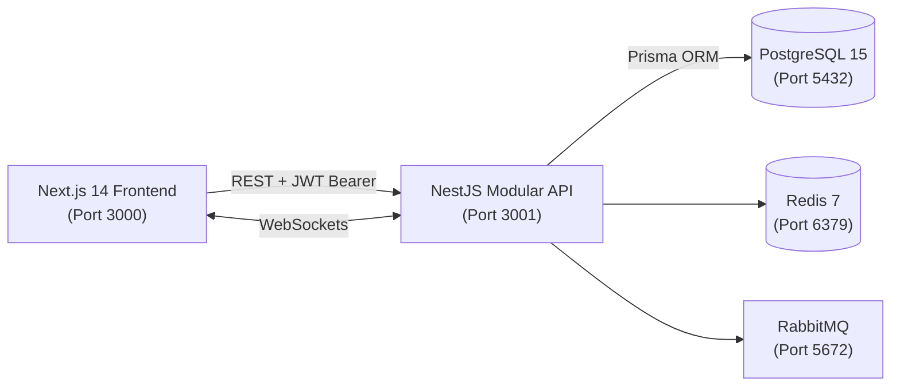
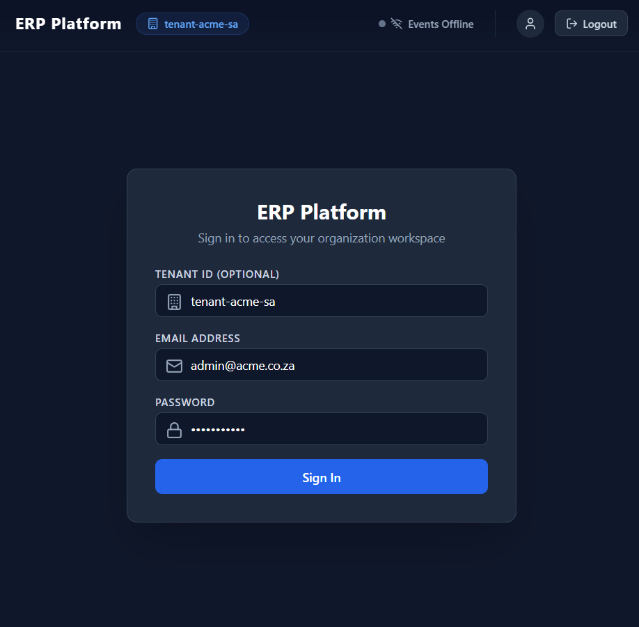
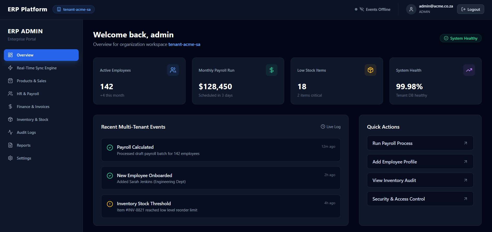
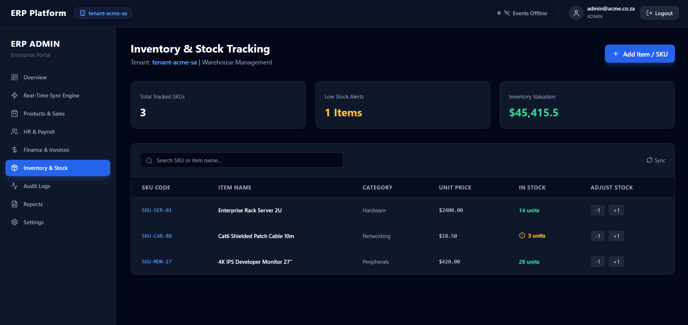
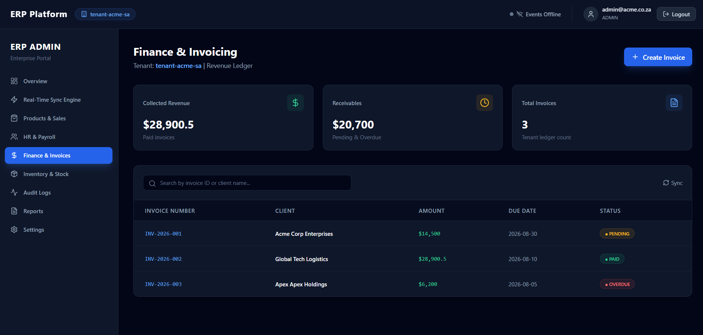

# Multi-Tenant Enterprise Resource Planning (ERP) Platform


A full-stack, multi-tenant ERP platform engineered with **Next.js 14**, **NestJS**, **Prisma ORM**, and **PostgreSQL**, backed by **Redis** and **RabbitMQ** via Docker Compose. Built to model real-world enterprise operations across finance, inventory, procurement, sales, and human resources.

---

## Key Architectural Highlights

- **Multi-Tenant Data Isolation:** Scopes users, inventory, accounting entries, and HR records by `tenantId` with JWT-based authentication and role claims.
- **15+ Integrated Domain Modules:** Covers Products, Multi-Warehouse Inventory & Stock Transfers, Suppliers, Purchase Orders, Sales Orders, Supplier Invoices, Double-Entry General Ledger (Trial Balance), Payroll & HR, Approvals, Audit Logs, and Analytics.
- **Event-Driven & Real-Time Ready:** Uses RabbitMQ for asynchronous messaging, Redis for caching, and WebSocket gateways for live workspace notifications.
- **End-to-End Type Safety:** Shared TypeScript workflows across the React/Next.js frontend and modular NestJS REST API.

---

## System Architecture



---

## Screenshots

| Authentication | Executive Dashboard |
| :---: | :---: |
|  |  |

| Inventory & Products | General Ledger |
| :---: | :---: |
|  |  |

---

## Local Setup & Quick Start

### Prerequisites
- Node.js 20+
- Docker & Docker Compose

### 1. Start Infrastructure (PostgreSQL, Redis, RabbitMQ)
```bash
docker compose up -d
```

### 2. Configure Environment Variables
```bash
cp apps/api/.env.example apps/api/.env
cp apps/web/.env.example apps/web/.env.local
```

### 3. Initialize Database & Start the NestJS API
```bash
cd apps/api
npm install
npx prisma db push
npx prisma db seed
npm run start:dev
```
The API will be available at `http://localhost:3001` (Interactive Swagger OpenAPI docs at `http://localhost:3001/api/docs`)`.

### 4. Start the Next.js Frontend
In a second terminal:
```bash
cd apps/web
npm install
npm run dev
```
Open `http://localhost:3000/login` in your browser.

---

## Demo Credentials

The database seed script creates a pre-populated South African demo tenant (**Acme SA**) with sample products, inventory, ledger accounts, and employees:

| Field | Value |
| :--- | :--- |
| **Tenant ID** | `tenant-acme-sa` |
| **Email** | `admin@acme.co.za` |
| **Password** | `password123` |

---

## Core API Modules

| Module | Base Route | Responsibility |
| :--- | :--- | :--- |
| **Auth** | `/auth` | Credential validation & JWT issuance |
| **Analytics** | `/analytics` | KPIs, monthly sales, top products & warehouse valuation |
| **Products & Inventory** | `/products`, `/inventory`, `/stock-transfers` | Catalog management, stock levels & inter-warehouse transfers |
| **Procurement & Sales** | `/suppliers`, `/purchase-orders`, `/sales-orders` | Vendor management & order lifecycle |
| **Finance** | `/general-ledger`, `/supplier-invoices` | Double-entry journal postings, trial balance & AP invoices |
| **HR & Payroll** | `/hr` | Employee directory & payroll processing |
| **Governance** | `/approvals`, `/audit-logs`, `/notifications` | Workflow approvals, audit trails & real-time alerts |

---

## License

Distributed under the [MIT License](LICENSE).
